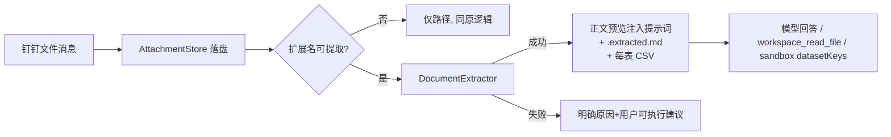

# 附件(Office/CSV)解析失败:根因分析与修复方案

> 状态:P0/P1/P2 已全部实现并通过测试(pptx / docx / xlsx / csv / pdf、旧版格式转换、图片识别、图表与日期、分页读取、指标、skill)。

## 1. 问题现象

用户在钉钉上传 `钉钉机器人的搭建和运营.pptx`,机器人回复"PPTX 正文未能成功解析",并让用户粘贴大纲或联系管理员。

## 2. 根因

附件链路为 `AttachmentStore`(下载落盘)→ `MessageEnricher`(拼进提示词)→ 模型调用 `workspace_read_file`。

| 环节 | 问题 |
|---|---|
| `AttachmentStore` | 只下载并落盘,`.pptx/.docx/.xlsx` 只登记了 MIME,**没有任何内容提取** |
| `MessageEnricher` | 只给模型一个"本地路径",仅图片有视觉识别;提示词只说"文本/CSV/JSON/MD 可用 workspace_read_file 读取" |
| `workspace_read_file` | 按 UTF-8 文本读取,OOXML 本质是 ZIP,被 `looksBinary` 拒绝 → 报"二进制内容,无法按文本读取" |
| 沙盒 / 依赖 | 沙盒是 isolated-vm,无 Python/Office 库;`package.json` 无任何 Office 解析依赖 |
| 失败话术 | 模型拿不到报错语义,套用了"联系管理员"兜底话术,用户无法自助 |

结论:不是 PPT 文件有问题,而是**项目从未具备 Office 解析能力**,所有 pptx/docx/xlsx 都会失败。附带发现:Excel 导出的 GBK CSV 会读成乱码。

## 3. 方案设计

原则:**入站即解析**(模型第一轮就看到正文)、**零新增依赖**(纯 Node)、**失败可自助**(明确原因与操作建议)。

### 3.1 新增模块

| 文件 | 职责 |
|---|---|
| [ZipReader.ts](file:///Users/tuwan/work/code/aider/anthys/src/documents/ZipReader.ts) | 基于 `node:zlib` 的最小 ZIP 读取;限制条目数与单条解压大小(防 zip bomb);识别加密/ZIP64 |
| [xml.ts](file:///Users/tuwan/work/code/aider/anthys/src/documents/xml.ts) | XML 实体解码、属性/文本收集 |
| [DocumentExtractor.ts](file:///Users/tuwan/work/code/aider/anthys/src/documents/DocumentExtractor.ts) | pptx/docx/xlsx/csv 提取,输出 Markdown;旧版格式与损坏文件抛带 `reason` 的错误 |
| [AttachmentDigest.ts](file:///Users/tuwan/work/code/aider/anthys/src/multimodal/AttachmentDigest.ts) | 对落盘附件提取,写旁路文件 `*.extracted.md` 与 `*.N-表名.csv` |

### 3.2 各格式提取规则

- **PPTX**:按 `presentation.xml` 的真实播放顺序;标题占位符→页标题;文本框→要点;表格→Markdown 表;讲者备注;忽略页码/页脚;图表/图片仅提示"未提取"。
- **DOCX**:`Heading n`/`标题 n`→`#`;列表→`-`;表格→Markdown 表。
- **XLSX**:共享字符串/内联字符串/布尔;补齐空列;隐藏表提示;提示预览 60 行,**完整 CSV 落盘**供 `sandbox_analyze_and_aggregate` 的 `datasetKeys` 整表分析。
- **CSV/TXT**:UTF-8 优先,失败回退 GB18030,并转存 UTF-8 CSV。
- **.ppt/.doc/.xls(旧版 OLE)**:不解析,提示"另存为新版格式后重传"。

### 3.3 接入点

1. `MessageEnricher`:附件落盘后自动解析,正文预览(≤8000 字)进入提示词;失败时注入明确原因,并指示模型"如实告知原因、不要让用户联系管理员、不要编造内容"。
2. `workspace_read_file`:遇到 Office 扩展名自动走提取而非报二进制;纯文本读取也支持 GBK 回退。
3. 通过 `documents: false` 可在 `enrichInboundMessage` 依赖中关闭(回滚开关)。

### 3.4 安全与限制

- 只读本地已落盘文件,不执行宏(`.xlsm/.pptm/.docm` 仅当作 zip 读 XML)。
- 单条目解压 ≤ 64MB,条目数 ≤ 5000,Office 文件 ≤ 50MB,提取文本 ≤ 200k 字。
- 加密文档返回"请先去除密码保护"。
- 图片、图表内容当前不识别(见 P1)。

## 4. 验证

- 单测 [DocumentExtractor.test.ts](file:///Users/tuwan/work/code/aider/anthys/src/documents/DocumentExtractor.test.ts):pptx(顺序/备注/页码过滤)、docx(标题/表格)、xlsx(CSV 补列)、旧版格式、损坏文件、GBK CSV。
- 回归:`vitest run src/multimodal src/tools/workspace` 全部通过,`tsc --noEmit` 无错误。
- 上线验证:重新上传 `钉钉机器人的搭建和运营.pptx`,应直接得到摘要选项并附带内容理解;`.ppt` 应得到"另存为 .pptx"提示。

## 5. 第二阶段增强(已实现)

| 能力 | 实现 | 位置 |
|---|---|---|
| PDF 文字层提取 | 引入 `unpdf`(纯 JS);无文字层判定为扫描件并给出导出图片建议;加密 PDF 明确提示 | [DocumentService.ts](file:///Users/tuwan/work/code/aider/anthys/src/documents/DocumentService.ts) |
| 内嵌图片识别 | pptx/docx 提取 ≥8KB 的图片(最多 8 张),启用视觉模型时逐张识别,并入正文预览的“内嵌图片识别”段,图片另存 `*.media/` | [AttachmentDigest.ts](file:///Users/tuwan/work/code/aider/anthys/src/multimodal/AttachmentDigest.ts) |
| 旧版 .ppt/.doc/.xls | 可选 LibreOffice headless 转换(`SOFFICE_PATH` 或自动探测);不可用时保持“另存为新版格式”提示 | [LegacyConverter.ts](file:///Users/tuwan/work/code/aider/anthys/src/documents/LegacyConverter.ts) |
| pptx 图表数据 | 解析图表缓存(系列/分类/数值)为 Markdown 表 | [DocumentExtractor.ts](file:///Users/tuwan/work/code/aider/anthys/src/documents/DocumentExtractor.ts) |
| xlsx 日期 | 按 `styles.xml` 的 numFmt 判定日期单元格,转 ISO 日期(支持 1904 体系) | 同上 |
| 长文档分页 | `workspace_read_file` 新增 `offset` 参数,返回“下一页 offset” | [WorkspaceReadToolProvider.ts](file:///Users/tuwan/work/code/aider/anthys/src/tools/workspace/WorkspaceReadToolProvider.ts) |
| 指标 | `agent_document_extract_total{format,result}`,result 为 `ok` / `unsupported` / `corrupt` / `empty` / `io` | `src/index.ts` |
| Skill | 新增内置 [attachment-analysis](file:///Users/tuwan/work/code/aider/anthys/skills/builtin/attachment-analysis/SKILL.md):四种意图流程、分页读取、失败话术、注入防护 | `skills/builtin/` |

### 部署注意

- 新增依赖 `unpdf`,需 `pnpm install`;改动后需重启服务。
- 要支持旧版 Office,在容器镜像里安装 `libreoffice-impress libreoffice-writer libreoffice-calc`,或设置 `SOFFICE_PATH`;不装也不影响其他格式。
- 视觉模型未启用时,图片只提示“未识别”,不影响文字提取。

### 测试

[DocumentExtractor.test.ts](file:///Users/tuwan/work/code/aider/anthys/src/documents/DocumentExtractor.test.ts)、[DocumentService.test.ts](file:///Users/tuwan/work/code/aider/anthys/src/documents/DocumentService.test.ts) 覆盖:图表、日期、PDF(含扫描件)、旧版格式降级、内嵌图片识别、解析失败原因。

### 已知边界

- 扫描版 PDF、PPT 中整页是图片的情况:只能靠用户导出图片后走视觉识别。
- 钉钉在线文档/表格链接不属于附件,继续走 `dws_doc_search_and_read`(见 `link-reader`、`dingtalk-office` skill)。
- 图表只提取缓存数据,不还原图表样式;SmartArt、文本框内公式等未提取。
- 全量测试中 `ToolRegistry` / `AdminChatOps` / `IsolatedSandbox` 三个文件因 `isolated-vm` 与当前 Node 版本不匹配而加载失败,改动前同样存在,与本修复无关(`pnpm rebuild isolated-vm` 可修复)。
