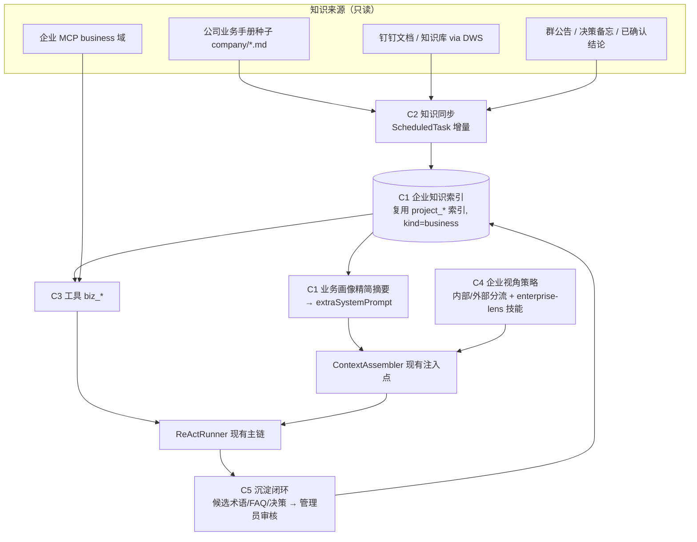

# 企业业务认知增强（Enterprise Knowledge Enrichment）设计与开发文档

> 状态：方案草案 v1　日期：2026-11-06
> 定位：**丰富**现有主链，不改造主链。所有新增能力都挂在已有扩展点上（`IToolProvider`、`extraSystemPrompt`、Skill/Plugin、Project 索引、Glossary、ScheduledTask、DynamicConfigCenter），默认关闭，关闭后行为与现状完全一致。

---

## 1. 现状与差距

### 1.1 已有的主链（保持不动）

```
钉钉 Stream → 路由(单聊/@/旁听) → AgentHarness
   → ContextAssembler(persona + SAFETY + TOOL_GUIDANCE + extraSystemPrompt[extension, glossary, person] + 三层记忆)
   → ReActRunner(工具: 企业MCP · DWS · project_* · github · web · sandbox · glossary_lookup …)
   → AI 卡片流式输出 → 落库 / 异步记忆压缩 / 术语抽取
```

已有的"企业认知"资产：

| 资产 | 作用 | 局限 |
| --- | --- | --- |
| 术语库 `GlossaryService` | 术语/职责注入 prompt（`buildGlossaryPrompt`） | 只回答"这个词是什么"，没有业务全貌（业务线、流程、指标口径、制度） |
| 项目手册 `project_*` 工具 | 代码/仓库级问答，带引用 | 面向代码，不面向业务 |
| 企业 MCP（`domain: business` 等） | 实时数据、日志、接口文档 | 靠模型自己判断何时调用，无"业务场景→该查什么"的引导 |
| DWS 文档/审批/日程 | 个人办公数据 | 按需查询，没有沉淀成可检索的公司知识 |
| 三层记忆 | 对话级记忆 | 来源是聊天，不是权威知识 |
| Skill / Plugin | 渐进披露的流程指引 | 内置技能偏办公与代码，缺"业务分析视角"类技能 |

### 1.2 差距（对应你的目标）

1. **知识不饱满**：缺公司业务全貌（组织、业务线、产品、客户分层、流程、指标口径、SLA、制度），模型只能给通用答案。
2. **信息不及时**：权威知识散落在钉钉文档/知识库/群公告/审批流/MCP 系统里，没有"增量同步 + 新鲜度标注"机制。
3. **视角不稳定**：回答是否站在公司真实场景，取决于用户问得是否清楚；没有"内部问题自动带公司视角、外部问题不强加"的策略。
4. **没有闭环**：对话里产生的结论、决策、新术语沉淀不到权威知识，更新靠人工。
5. **不可度量**：缺少企业问答的评测集与新鲜度/引用覆盖率指标。

---

## 2. 总体方案：企业知识层（EKL）

五个增量组件，全部沿用已有模式，**不新增并行主链**：



### C1　企业业务画像（Business Profile）——"知道公司是什么样"

**做法**：把公司当成一个特殊的"项目"登记（`ProjectRegistry` 新增 `kind: 'business'`，或独立 project id `company`），种子目录 `projects/company/manual/`，复用 `ProjectSeed`、`HandbookBuilder` 的草稿→发布版本、控制台章节编辑器、`.anthysignore`、权限过滤，**不新建存储与检索**。

建议章节（人工条目为主，确定性生成为辅）：

| 章节 | 内容 |
| --- | --- |
| 组织与职责 | 部门、岗位、对口人（与 Glossary 职责画像互链） |
| 业务线与产品 | 业务模式、产品矩阵、客户分层、上下游 |
| 核心流程 | 下单/履约/售后/采购/审批流程与关键节点、SLA |
| 指标口径 | 指标定义、口径、数据源、负责人（"订单超时"到底怎么算） |
| 制度与合规 | 报销、权限、数据安全、对外口径 |
| 系统地图 | 内部系统 ↔ 企业 MCP 工具 ↔ 负责人（回答"去哪查"） |
| 当前重点 | 本季度目标、在途项目、已知风险（高频更新，带有效期） |

**注入方式**（只加不改）：`AgentHarness.buildExtraSystemPrompt` 已有 `[extension, glossary, person]` 拼接，新增第 4 段 `businessProfilePrompt`：

- 固定 ≤ 600 字的"公司一页纸"（业务线 + 口径要点 + 系统地图索引），会话级缓存，随手册版本失效；
- 其余内容**不进 prompt**，由 C3 工具按需检索，避免撑爆上下文。

### C2　知识同步（Freshness）——"知道公司最新"

**做法**：复用 `ScheduledTaskScheduler` / `JobRunner`，新增 `ScheduledTaskKind = 'knowledge_sync'`，与现有 `daily_report` 同级。

| 来源 | 同步方式 | 频率 | 新鲜度策略 |
| --- | --- | --- | --- |
| 钉钉知识库/指定文档 | DWS `doc` 只读命令，按 `updatedAt` 增量；白名单文档空间 | 30 min | 以源端更新时间为准 |
| 公司手册种子 | 文件变更触发（`ProjectSeed` 现有机制） | 启动/发布 | 版本号 |
| 群公告 / 决策备忘 | 管理员确认后入库（见 C5） | 事件 | 带 `valid_until` |
| 企业 MCP 实时数据 | **不入库**，实时调用 | 实时 | 响应带取数时间 |

核心原则——**易变信息走实时工具，稳定信息走索引**：

- 库存、订单、指标数值、故障状态 → 必须调 MCP/DWS，答案标注"取数时间"；
- 制度、流程、口径、组织 → 走索引，答案标注"来源 + 更新时间"；
- 超过 `staleAfterDays` 的条目，回答时附带"该信息更新于 X，建议核实"。

增量失败只记录 `syncError` 并保留旧快照（沿用 embedding 降级思路），不影响主链。

### C3　业务检索工具（`biz_*`，新 `IToolProvider`）

放在 `src/tools/business/BusinessToolProvider.ts`，只读，风险级别 `read`，经现有 `ToolRegistry`/`ToolExecutionPolicy`/`toolRisk` 与白名单管控：

| 工具 | 作用 |
| --- | --- |
| `biz_search` | 在企业知识索引里混合检索（关键词 + 向量），返回片段 + 来源 + 更新时间 + 密级 |
| `biz_metric` | 查指标口径定义与数据源，并给出"去哪个 MCP 工具取数"的指引 |
| `biz_owner` | 某业务/系统/流程的责任人与对口群（读 Glossary 职责 + 系统地图） |
| `biz_context` | 针对一个问题返回"相关业务背景包"（流程 + 口径 + 在途重点 + 风险），供多步推理开头一次调用 |

实现上 `biz_*` 只是 `ProjectSearchService` / `GlossaryService` 之上的薄封装，不引入新的检索引擎。

### C4　企业视角策略（Enterprise Lens）——"站在公司角度想"

只用 **Skill + 一段 prompt**，不动 Planner/ReAct：

1. 新增内置技能 `skills/builtin/enterprise-lens/SKILL.md`（`when_to_use`：涉及公司业务、流程、指标、客户、故障、决策、汇报等内部问题）。
   经现有 `SkillRouter` 渐进披露，命中才加载，不占常驻 token。
2. 技能内的回答框架（内部问题）：
   1. **结论先行**（一句话）
   2. **公司口径/依据**（引用 `biz_*` 或 MCP 结果，注明来源与时间）
   3. **业务影响**（影响哪条业务线、哪类客户、哪个指标）
   4. **风险与合规**（权限、数据密级、对外口径）
   5. **下一步与责任人**（对口人/群，可转 DWS 待办，需确认）
   6. **缺口说明**（哪些信息没查到，不编造）
3. **内外分流**（写进技能与 `TOOL_GUIDANCE` 增补一行，而非代码分支）：
   - 内部问题：先 `biz_context`/`biz_search`，再按需调 MCP；主动补充"相关口径、历史类似事件、对口人"；
   - 外部通用问题（行业知识、公开技术）：按原链路回答，可用 `web_search`，**不强加公司视角**；
   - 两者混合：外部事实 + "对我们意味着什么"两段分开写。
4. 补充 2~3 个业务向技能：`business-diagnosis`（指标异常归因）、`customer-brief`（客户/项目背景简报）、`process-guide`（流程办理指引，衔接 `dingtalk-office`）。

### C5　沉淀闭环（Knowledge Capture）——"越用越懂公司"

复用现有"术语抽取 / 决策备忘（`decision-memo`）/ 旁听 / handbook-maintainer"：

- 对话结束后的异步抽取，在现有"术语与职责画像"之外新增**候选知识**三类：口径修正、流程结论、决策；
- 一律进入 **候选区（`status=candidate`）**，管理员在控制台审核后才进入索引（沿用 Glossary 的 `timeliness` / `sensitivity` 与冲突检测 `GlossaryConflictError` 思路）；
- 来源、提出人、确认人、有效期全程留痕，复用 `governance` 审计；
- 旁听仅产出候选，**不得自动写入权威知识**。

---

## 3. 权限与安全（硬约束）

| 规则 | 实现 |
| --- | --- |
| 密级沿用 | 条目 `sensitivity: public/team/sensitive`；群聊仅可见 `public/team`，单聊按提问人身份再过滤（与 Glossary 现有 `conversationType` 过滤一致） |
| 不越权 | `biz_*` 调用走 `ExecutionContext` 的身份；DWS 同步使用专用只读账号 + 文档空间白名单，**不用提问人权限批量抓取** |
| 不跨群泄露 | `SAFETY_GUARDRAILS` 原样保留；候选知识带来源群，未审核不对外 |
| 敏感脱敏 | 入索引前过 `governance/redaction` |
| 可关停 | `BIZ_KNOWLEDGE_ENABLED=false` 即回到现状；配置经 `DynamicConfigCenter` 热更新 |
| 写操作不变 | 一切写操作仍走现有 `ToolApprovalGate` / `/confirm` |

---

## 4. 具体改动清单（均为新增，主链改动 ≤ 约 20 行）

| # | 文件 | 类型 | 说明 |
| --- | --- | --- | --- |
| 1 | `projects/company/project.json` + `manual/*.md` | 新增 | 公司业务画像种子（空模板 + 示例，真实内容由业务方填写） |
| 2 | `src/types/skills-plugins-projects.ts` | 小改 | `Project.kind` 增加 `'business'`；条目增加 `validUntil`、`sourceUpdatedAt` 字段（可空） |
| 3 | `src/projects/ProjectService.ts` / `ProjectStore.ts` | 小改 | 检索结果透出更新时间；`sensitivity` 过滤；`kind=business` 白名单 |
| 4 | `src/knowledge/KnowledgeSyncService.ts` | 新增 | DWS 文档增量同步 + 降级 + 统计 |
| 5 | `src/scheduler/ScheduledTaskScheduler.ts`、`types/admin-and-console.ts` | 小改 | 新增 `knowledge_sync` kind 的执行分支 |
| 6 | `src/tools/business/BusinessToolProvider.ts` | 新增 | `biz_search / biz_metric / biz_owner / biz_context` |
| 7 | `src/index.ts` | 小改 | 注册 provider（受开关控制） |
| 8 | `src/harness/AgentHarness.ts` | 小改 | `buildExtraSystemPrompt` 追加 `buildBusinessProfilePrompt`（带缓存、预算、try/catch 降级，写法对齐 `buildGlossaryPrompt`） |
| 9 | `src/memory/ContextAssembler.ts` | 小改 | `TOOL_GUIDANCE` 追加 2 行：内部问题先查公司口径；易变数据必须实时取数并标注时间 |
| 10 | `skills/builtin/enterprise-lens/`、`business-diagnosis/`、`customer-brief/`、`process-guide/` | 新增 | 技能 |
| 11 | `src/knowledge/KnowledgeCaptureService.ts` + 控制台"候选知识"页 | 新增 | C5 候选区与审核 |
| 12 | `eval/golden/company.json`、`src/eval/*` | 新增 | 企业问答评测集（见 §6） |
| 13 | `.env.example` | 小改 | `BIZ_KNOWLEDGE_ENABLED`、`BIZ_PROFILE_PROMPT_MAX_CHARS`、`BIZ_STALE_AFTER_DAYS`、`KNOWLEDGE_SYNC_SPACES` |

---

## 5. 分期实施

| 期 | 目标 | 内容 | 验收 |
| --- | --- | --- | --- |
| **P0（1 周，零代码风险）** | 先让回答"像公司的人" | 填写 `company` 手册种子；新增 `enterprise-lens` 技能；`TOOL_GUIDANCE` 两行；系统地图（业务 ↔ MCP 工具）写进手册 | 人工抽测 20 题，企业视角与口径命中显著提升 |
| **P1（1~2 周）** | 可检索 | `kind=business` 项目登记；`biz_search / biz_owner / biz_metric`；画像一页纸注入（受开关控制） | golden 引用命中 ≥ 90%；prompt 增量 ≤ 600 字；关闭开关后行为不变 |
| **P2（2 周）** | 保持最新 | `knowledge_sync` 定时同步 DWS 文档；新鲜度标注与过期提示；`biz_context` | 文档更新后 ≤ 1 个同步周期可被检索到；过期条目有提示 |
| **P3（2 周）** | 越用越懂 | 候选知识抽取 + 管理员审核；业务向技能；指标面板（采用率、命中率、过期率） | 候选采纳率可统计；无未审核内容进入权威库 |

> 建议先做 P0：成本最低、见效最快，且能顺带暴露"手册里到底缺什么"。

---

## 6. 评测与指标

- **企业 golden set**（`eval/golden/company.json`，沿用 `pnpm eval:golden`）：50 题，覆盖口径/流程/责任人/系统去哪查/制度/混合内外题，另含 10 题"外部问题不应强加公司视角"的反例、10 题越权/密级题。
- 指标：
  - 引用命中率 ≥ 90%、事实覆盖 ≥ 85%；
  - **新鲜度**：被引用条目中过期占比 < 5%；同步延迟 p95；
  - **企业视角率**（抽样人工）：内部问题中包含口径/影响/责任人的比例；
  - **安全**：密级/越权题通过率 100%；
  - **成本**：每轮新增 prompt token ≤ 800；`biz_*` 平均调用数 ≤ 2。
- 线上：复用 `admin-api/metrics.ts` 增加 `biz_search_hit`、`biz_stale_hit`、`kb_sync_fail` 计数。

---

## 7. 风险与对策

| 风险 | 对策 |
| --- | --- |
| 手册内容没人维护 → 过期误导 | 每条带 `owner` 与 `validUntil`；过期提示；控制台"即将过期"列表；候选闭环降低录入成本 |
| prompt 膨胀、变慢 | 画像一页纸硬上限；其余按需检索；会话缓存 |
| 越权泄露 | 密级过滤 + 专用只读同步账号 + 空间白名单 + 脱敏；评测含越权题 |
| 模型把"公司视角"套到外部问题 | 技能内明确分流；评测含反例 |
| 模型编造公司信息 | 框架要求"缺口说明"；无来源不得断言公司口径；引用沿用 `citations.ts` |
| 改动影响主链 | 全部新增 + 开关；主链改动仅 prompt 追加段与 provider 注册，沿用 try/catch 降级 |

---

## 8. 需要你确认的决策

1. 公司权威知识的主要载体是？（钉钉知识库 / 钉钉文档 / 企业 MCP 某系统 / 其他）——决定 P2 同步的数据源。
2. 是否可以提供一个只读的专用 DWS 同步账号与文档空间白名单？
3. 业务手册由谁维护（建议每个业务线 1 名 owner）？
4. 候选知识由谁审核（沿用现有管理员，还是按业务线分权）？
5. 是否同意先落地 P0（仅内容 + 技能 + 两行 prompt，无新增代码依赖）？
