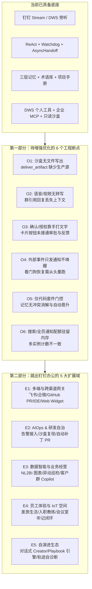
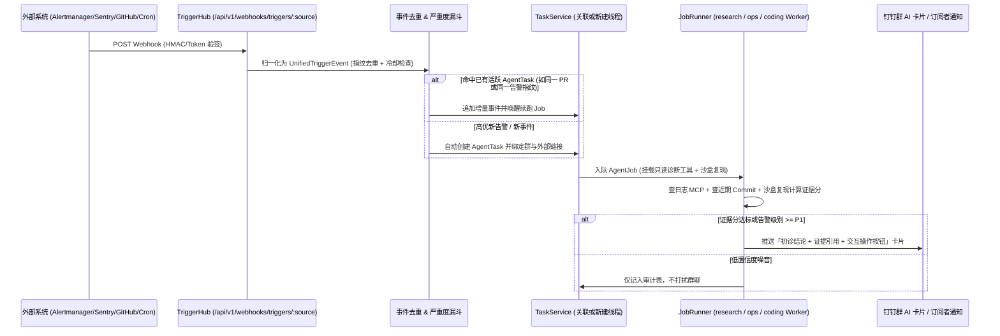

# 钉钉智能体（Anthys）下一阶段增强优化与跨领域扩展开发文档

> 版本：v1.0  
> 日期：2026-11-22  
> 适用仓库：`anthys`（钉钉智能体）  
> 读者：架构师、后端/前端研发、SRE、产品与业务负责人  
> 定位：基于当前仓库真实代码基线（已完成三级旁听漏斗、三层记忆、ReAct 看门狗、异步接管 `AsyncTurnHandoff`、`dispatch_worker`、每员工独立 DWS 身份、16 页管理控制台），系统梳理**现有架构的短板增强项（Optimization）**与**跳出钉钉纯办公场景的跨领域扩展蓝图（Expansion）**，并给出可直接落地的分阶段开发规范。

---

## 目录

1. [现状基线与核心诊断](#1-现状基线与核心诊断)
2. [第一部分：现有能力深度增强与架构优化（6 大优化专项）](#2-第一部分现有能力深度增强与架构优化6-大优化专项)
   - [O1. 产物生成与投递闭环（打通沙盒可写输出、文档生成与图表渲染）](#21-o1-产物生成与投递闭环打通沙盒可写输出文档生成与图表渲染)
   - [O2. 全模态入站补齐（语音 ASR 识别、视频摘要与引用消息上下文提取）](#22-o2-全模态入站补齐语音-asr-识别视频摘要与引用消息上下文提取)
   - [O3. 互动卡片 2.0 闭环（审批/授权/反馈按钮化与超长内容自动转文档）](#23-o3-互动卡片-20-闭环审批授权反馈按钮化与超长内容自动转文档)
   - [O4. 事件直通执行体与断点续跑（Event-to-Worker 唤醒与 Step Checkpoint）](#24-o4-事件直通执行体与断点续跑event-to-worker-唤醒与-step-checkpoint)
   - [O5. 认知层与工具调度精度提升（多域工具门控、记忆消歧晋升、AST 索引）](#25-o5-认知层与工具调度精度提升多域工具门控记忆消歧晋升ast-索引)
   - [O6. 分布式一致性收口（全局配额、冷却与缓存共享化）](#26-o6-分布式一致性收口全局配额冷却与缓存共享化)
3. [第二部分：跳出钉钉办公领域的跨场景扩展蓝图（5 大扩展方向）](#3-第二部分跳出钉钉办公领域的跨场景扩展蓝图5-大扩展方向)
   - [E1. 跨渠道与多端统一智能体网关（Omni-Channel & Multi-Surface）](#31-e1-跨渠道与多端统一智能体网关omni-channel--multi-surface)
   - [E2. 研发工程与 AIOps/SRE 自治闭环（从只读查证到告警触发、沙盒复现与补丁 PR）](#32-e2-研发工程与-aiopssre-自治闭环从只读查证到告警触发沙盒复现与补丁-pr)
   - [E3. 数据智能（NL2BI）、业务经营巡检与外部客户服务（Customer-Facing Copilot）](#33-e3-数据智能nl2bi业务经营巡检与外部客户服务customer-facing-copilot)
   - [E4. 员工全旅程关怀、LBS 差旅生活与智能办公硬件/IoT 联动](#34-e4-员工全旅程关怀lbs-差旅生活与智能办公硬件iot-联动)
   - [E5. 智能体自演进生态：Creator Mode、声明式 Playbook 与轨迹自反哺](#35-e5-智能体自演进生态creator-mode声明式-playbook-与轨迹自反哺)
4. [第三部分：详细技术设计规范（接口、表结构与核心流程）](#4-第三部分详细技术设计规范接口表结构与核心流程)
5. [第四部分：安全边界与治理红线](#5-第四部分安全边界与治理红线)
6. [第五部分：分阶段研发路线图（Roadmap）与验收标准](#6-第五部分分阶段研发路线图roadmap与验收标准)

---

## 1. 现状基线与核心诊断

经过近期架构演进，本项目在**单体企业 Agent 的工程完成度**上已具备非常扎实的底座：

- **入站与卡片**：支持 Stream 模式、AI 卡片单字段流式输出（`CardStreamer`）、表情贴纸反馈、图片视觉转录（`VisionDescriber`）与 Office/PDF 文档提取（`DocumentExtractor` + `LegacyConverter`）。
- **推理与调度**：具备 KV 缓存前缀稳定化（`ContextAssembler`）、瞬态重试（`modelRetry`）、确定性运行看门狗（`RunWatchdog`）、前台超时自动转后台（`AsyncTurnHandoff`）、多 Worker 路由（`WorkerToolProvider` 的 `dispatch_worker`）以及工具两级加载雏形（`ToolSuiteGate`）。
- **管控与安全**：每员工独立 DWS Profile 隔离与自动续跑（`DwsIdentityService` + `DwsWriteTaskService`）、执行层工具白名单（`ScopedToolProvider`）、写操作二次确认（`ToolApprovalGate`）及幂等执行台账（`ToolExecutionLedger`）。

但结合代码实现细节与真实高频使用场景审视，当前系统仍存在**六个明显的“半闭环”工程断点**，且能力边界仍主要局限于**“钉钉群/单聊内的被动问答与个人 OA 事务”**。



---

## 2. 第一部分：现有能力深度增强与架构优化（6 大优化专项）

### 2.1 O1. 产物生成与投递闭环（打通沙盒可写输出、文档生成与图表渲染）

- **现状与代码证据**：
  - 仓库已提供产物投递工具 `deliver_artifact`（[`src/tools/artifacts/ArtifactToolProvider.ts:53-119`](../src/tools/artifacts/ArtifactToolProvider.ts#L53)），允许把 `.workspace` 下的文件发回钉钉会话。
  - **但系统没有任何工具能向 `.workspace` 写入新文件**：[`src/tools/workspace/`](../src/tools/workspace/) 仅有 `WorkspaceReadToolProvider.ts`（只读）；而在隔离沙盒 [`src/tools/sandbox/IsolatedSandbox.ts:271-426`](../src/tools/sandbox/IsolatedSandbox.ts#L271) 中，JavaScript 运行于无文件系统的 `isolated-vm`，Python/Bash 运行于 `--read-only` 且挂载 `-v ${workDir}:/workspace:ro` 的 Docker 容器，并在 `finally` 中立即 `rm(workDir)`。
  - **后果**：用户要求“把查询结果导出成 Excel 发我”、“画一张近 30 天趋势图发群里”、“生成一份排障报告 Word 文档”时，模型虽然有 `deliver_artifact` 工具，却无法真正生成任何文件。
- **增强方案**：
  1. **沙盒受控产物输出目录（Sandbox Output Mount）**：
     - 在 `IsolatedSandbox.executeDocker` 中挂载一个独立可写子目录 `-v ${outDir}:/workspace/out:rw`（限制总大小 ≤ 20MB、文件数 ≤ 10、禁止符号链接与可执行二进制）。
     - 在 `isolated-vm` / Worker JS 沙盒中注入 `emitArtifact(fileName, contentOrBase64)` 宿主回调。
     - 执行结束后，沙盒自动将产物移动到 `.workspace/generated/<conversationHash>/<runId>/`，并在工具返回值中附带 `generatedFiles: [{ path, fileName, size, mimeType }]`，模型即可直接调用 `deliver_artifact` 发送。
  2. **内置结构化文档与图表生成工具（`artifact_generate`）**：
     - 支持将 Markdown / JSON 表格确定性转换为 `.xlsx`（多 Sheet 样式表格）、`.docx`（带企业页眉与样式的 Word）、`.pdf` 及 `.csv`。
     - 预置含 `matplotlib` / `pandas` / `openpyxl` / `python-docx` + 中文字体（Noto Sans CJK）的定制沙盒镜像 `anthys-sandbox-python:latest`，彻底解决沙盒画图乱码与缺库问题。

### 2.2 O2. 全模态入站补齐（语音 ASR 识别、视频摘要与引用消息上下文提取）

- **现状与代码证据**：
  - [`src/dingtalk/MessageParser.ts:20-96`](../src/dingtalk/MessageParser.ts#L20) 已能识别 `audio` 与 `video` 并下载落盘，同时把消息文本置为 `[语音]` 或 `[视频]`。
  - 但 [`src/multimodal/MessageEnricher.ts:114-178`](../src/multimodal/MessageEnricher.ts#L114) 只处理了 `image`（调用 `VisionDescriber`）和文档类 `file`（调用 `AttachmentDigest`）。员工在移动端发一条钉钉语音消息时，模型只能看到 `[语音] 本地路径：xxx` 而无法获知语音内容。
  - 此外，在钉钉群里员工常**引用（回复）某条历史报错或别人发的文件**再 `@小钉 帮我看看`，但 [`MessageParser.ts:124-173`](../src/dingtalk/MessageParser.ts#L124) 未解析钉钉 payload 中的 `repliedMsg` / `quoteContent` 字段，导致关键被引用上下文丢失。
- **增强方案**：
  1. **语音消息双通道转写（DingTalk Native ASR + OpenAI-compatible Audio API）**：
     - 优先提取钉钉机器人入站 `content.recognition` 原生语音识别字段（零延迟、零成本）。
     - 若为空或用户上传的是音频附件（`.mp3/.wav/.m4a/.amr/.ogg`），通过新增的 `AudioTranscriber`（对接 Whisper / SenseVoice / Paraformer / Qwen-Audio 兼容 `/v1/audio/transcriptions` 接口）转写为带时间戳的文本注入 `renderAttachmentSection`。
  2. **引用/回复消息（Quoted Reply）结构化解析**：
     - 在 `InboundMessage` 中新增 `quotedMessage?: { messageId?: string; senderNick?: string; text?: string; attachments?: InboundAttachment[] }`。
     - 若被引用消息仅含 `msgId`，自动从本地 `messages` 表或 `GroupTranscriptBuffer` 反查原文与附件路径并拼入当前提问上下文。
  3. **短视频/录屏关键帧提取**：
     - 对员工发来的报错录屏（`video` ≤ 20MB），利用受控 `ffmpeg` 抽取首尾及变化关键帧（最多 4 帧）+ 音轨转写，交由 `VisionDescriber` 识别报错画面。

### 2.3 O3. 互动卡片 2.0 闭环（审批/授权/反馈按钮化与超长内容自动转文档）

- **现状与代码证据**：
  - [`src/dingtalk/CardActions.ts:15-23`](../src/dingtalk/CardActions.ts#L15) 目前只把卡片按钮映射为 `/stop`、`/retry`、`/help`、`/status`、`/trace`。
  - 当触发写操作确认（`ToolApprovalGate`）或 DWS 授权时，用户必须在聊天框手动输入“确认”、“取消”或“同意授权”；回答结束后，用户也只能手动敲 `/feedback <内容>` 提交反馈。
  - [`src/dingtalk/CardStreamer.ts`](../src/dingtalk/CardStreamer.ts) 为防止钉钉卡片单块超长空白，在约 2400 字符处截断并用 `TextFallback` 按 1500 字符分片补发纯文本，导致长篇分析报告在群里连刷多条消息。
- **增强方案**：
  1. **卡片原生交互按钮扩展**：
     - 在待确认写操作卡片底部直接渲染 **「确认执行」**（携带 `actionId: "confirm:<pendingActionId>"`）与 **「取消」**（`actionId: "cancel:<pendingActionId>"`）按钮；`CardActions.ts` 解析后直接路由至审批执行器并原地更新卡片状态为“已确认执行 / 已取消”。
     - 在已完成回答的卡片底部提供轻量 **「有用」/「有误」/「转后台深入查」** 按钮，点击后一键写入 `user_feedback` 表并在管理台「消息流评测」统计满意度。
  2. **超长回答自动折叠与文档化交付**：
     - 当最终回答超过 2400 字符时，卡片正文展示“核心结论 + 结构化目录摘要（前 1800 字）”，同时自动将完整 Markdown 生成本地 `.md` / `.docx` 附件（或通过 `dws_doc_manage` 写入个人/群知识库文档），在卡片末尾附上文件消息或文档直达链接，不再用多条纯文本分片刷屏。

### 2.4 O4. 事件直通执行体与断点续跑（Event-to-Worker 唤醒与 Step Checkpoint）

- **现状与代码证据**：
  - [`src/tasks/TaskService.ts:252-318`](../src/tasks/TaskService.ts#L252) 与 [`src/bootstrap/backgroundSchedulers.ts:131-155`](../src/bootstrap/backgroundSchedulers.ts#L131) 已经实现了 GitHub Webhook 事件按 `agent_task_links` 路由到活跃 `AgentTask`，但 `onExternalEvent` **仅仅向订阅者发了一条纯文本通知**，并没有唤醒 Agent 或派生 `AgentJob` 去跟进分析（例如 PR 收到新评论或 CI 报错时，机器人不会自动去读失败日志并更新结论）。
  - 后台任务被 `RunWatchdog` 暂停后，用户执行 `/job-resume <ID> [补充要求]` 时，[`src/jobs/JobRunner.ts`](../src/jobs/JobRunner.ts) 会**从第 0 步重新跑整条任务**，丢失已消耗数万 Token 拿到的中间工具结果。
- **增强方案**：
  1. **事件直通唤醒（Event-Driven Task Continuation）**：
     - 升级 `TaskService.onExternalEvent` 与群消息入站路由：当匹配到活跃 `AgentTask`（且处于 `autoFollowUp: true` 且未在冷却期）时，自动将增量事件封装为一条 `kind: 'task_continuation'` 的 `AgentJob`，携带该 Task 的历史摘要与新增事件直接交由对应 `Worker`（如 `research` 或 `ops`）增量推理，得出新结论后再通知订阅者。
  2. **ReAct 步骤级检查点（Step-Level Checkpointing）**：
     - 在 `agent_jobs` 执行过程中，每完成一轮只读工具调用，将当前 `messages` 增量与工具输出快照写入 `agent_job_checkpoints`（或 `agent_jobs.checkpoint_state` JSONB 列）。
     - 当 `/job-resume <ID> <补充要求>` 触发时，从最近一次有效 Checkpoint 恢复上下文，追加用户的补充约束继续剩余步骤，节省 50%–80% 重复 Token 与等待时间。

### 2.5 O5. 认知层与工具调度精度提升（多域工具门控、记忆消歧晋升、AST 索引）

- **现状与代码证据**：
  - [`src/react/ToolSuiteGate.ts:16-23`](../src/react/ToolSuiteGate.ts#L16) 目前仅把 `projects` 和 `github` 收纳进 `PROJECT_CODE_SUITE`，其余 30+ 工具（12 个 DWS 工具、高德地图 MCP、Playwright 25 个浏览器工具、行情工具、群工作区工具等）仍全量常驻，既占用上下文又容易在弱模型上引发工具误选。
  - [`src/memory/HierarchicalMemoryManager.ts`](../src/memory/HierarchicalMemoryManager.ts) 抽取的语义记忆没有“新旧事实冲突覆写”机制（例如某系统的负责人变更后，旧记忆与新记忆同时被召回），且自动抽取的 `terminology` 记忆与正式术语库 `glossary_terms` 之间仍需手动搬运。
  - [`src/projects/CodeIndexer.ts`](../src/projects/CodeIndexer.ts) 采用正则与行扫描提取符号，对复杂 TypeScript/Python/Go 跨文件引用与 AST 语义块切分能力有限。
- **增强方案**：
  1. **多域工具套件分级门控（Multi-Suite Tool Gating）**：
     - 扩展 `ToolSuiteGate.ts`，新增 `dws_office_write`（日程/待办/审批/文档/日志写工具）、`browser_automation`（Playwright MCP）、`lbs_and_travel`（高德地图 MCP）、`finance_market`（行情取数）四大按需套件；高频只读检索工具保持常驻，使单轮默认工具数稳定控制在 12–15 个以内。
  2. **语义记忆冲突消解（Memory Superseding）与术语自动候选**：
     - 写入新语义记忆时，先对同 `scope + subjectKey + category` 做余弦相似度 > 0.85 检索；若检测到矛盾或更新（如职责变更、偏好更新），将旧记忆状态置为 `superseded` 并记录 `supersededBy`。
     - 当同一 `terminology` 语义记忆在不同会话中被高置信度抽取 ≥ 3 次时，自动投递至 `glossary_candidates` 待审池，管理员在控制台一键批准即可晋升为正式术语。
  3. **基于 `web-tree-sitter` 的 AST 级代码分块与调用图索引**：
     - 在 `CodeIndexer.ts` 中引入无需本地 C++ 编译的 WASM 版 `web-tree-sitter`，支持 TS/JS/Python/Go/Java 的函数、类、接口边界精准分块与 `calls / imports` 关系提取，提升代码问答与故障定位准确率。

### 2.6 O6. 分布式一致性收口（全局配额、冷却与缓存共享化）

- **现状与代码证据**：
  - 集群模式下虽然已有 `PgSharedStateStore`（[`src/cluster/SharedStateStore.ts`](../src/cluster/SharedStateStore.ts)），但 `web_search` 与 `web_fetch` 的小时/日配额与结果缓存、`group_notify_all` 的群冷却与每日配额、管理端在线对话一次性 SSE 票据（`chat/tickets`）仍保存在单实例进程内存中（见 `README.md` 已知边界）。
- **增强方案**：
  - 在 `SharedStateStore` 中抽象统一的原子计数器 `incrementWindowCounter(namespace, key, windowSeconds)` 与带 TTL 的 KV 读写接口；当 `CLUSTER_ENABLED=true` 时，将上述所有限流器、配额计数器与一次性票据全部统管到 PostgreSQL 共享状态表，彻底消除多实例水平扩容时的状态漂移。

---

## 3. 第二部分：跳出钉钉办公领域的跨场景扩展蓝图（5 大扩展方向）

为了更全面地服务团队与企业，本项目不应只局限于“钉钉内的日程/待办/审批问答”，而应以现有高可靠的 **Agent Harness + 三层记忆 + 权限闸门 + 沙盒执行** 为内核，向以下五个更广阔的领域延伸：

### 3.1 E1. 跨渠道与多端统一智能体网关（Omni-Channel & Multi-Surface）

让员工、研发人员甚至外部客户在不同工具与终端里使用的是**“同一个有共同记忆的智能体”**，而不是每个平台各自为政：

| 扩展终端 / 渠道 | 核心服务场景 | 复用与改造点 |
| --- | --- | --- |
| **飞书 / 企业微信 / Slack 适配器** | 跨组织并购、多协同软件并存团队、海外团队统一接入同一知识大脑 | 抽象 `IChannelAdapter`（入站解析、流式卡片输出、按钮回调、通讯录同步） |
| **IDE 插件与命令行终端（`anthys-cli` / VS Code 扩展）** | 研发在写代码或终端排障时，直接调用企业内部术语库、项目手册、线上日志 MCP 与历史排障记忆 | 在 `admin-api` 侧提供员工个人 PAT（Personal Access Token）鉴权的 `/api/v1/agent/chat` OpenAI 兼容流式端点 |
| **浏览器伴侣插件（Chrome/Edge Sidebar Extension）** | 员工浏览内部 Wiki、禅道/Jira、BI 报表或外部竞品网页时，划词解释黑话、一键总结页面、提取待办到钉钉 | 复用 SSE 对话流接口 + `PersonIdentityService` 跨端身份绑定 |
| **GitHub / GitLab 原生 PR Bot** | 在 PR 评论区 `@anthys review` 或自动触发代码审计，直接将审查意见作为 Line Comment 写回 PR，同步通知钉钉研发群 | 扩展 `GithubClient` 的受控评论/Review API + 双向链接 `agent_task_links` |
| **嵌入式 Web Widget（内部门户 / 外部官网客服）** | 嵌入公司 ERP、CRM、数据门户或对外帮助中心，提供带上下文的即时助手 | 新增轻量 `<script src="/widget.js">` 组件与租户级工具隔离 Profile |

### 3.2 E2. 研发工程与 AIOps/SRE 自治闭环（从只读查证到告警触发、沙盒复现与补丁 PR）

将机器人从“被动回答代码问题”升级为**全天候值守的数字 SRE 与研发拍档**：

1. **多源告警与可观测性事件中心（Observability Trigger Hub）**：
   - 新增统一 Webhook 接入点 `/api/v1/webhooks/alerts/:source`，内置对 **Prometheus Alertmanager、Grafana、Sentry、阿里云 SLS/ARMS、Datadog、GitHub Actions CI Failure** 的标准 Payload 解析器。
   - **自动化初诊工作流（Auto-Triage）**：当收到 P0/P1 告警时，机器人无需人工 @，自动唤醒 `ops` / `research` Worker：
     1. 查询告警时间窗前后的日志 MCP 与监控指标；
     2. 检索 `ProjectService` 与 GitHub 最近 24 小时内的相关 Commit / PR 及作者；
     3. 匹配历史 `task_results` 与 `silent_investigations` 中的相似故障；
     4. 在值班钉钉群投递一张**「故障初诊卡片」**（现象、疑似变更 Commit、相关责任人、3 条排查建议，以及「一键拉起故障任务线程」「通知相关人」按钮）。
2. **投机复现与自动补丁（Speculative Repro & Auto-Patch Worker）**：
   - 升级 `SilentInvestigationService` 与新增 `coding` Worker：在隔离 Docker 容器中以只读底层 + `overlayfs` 可写层挂载目标项目快照，自动编写最小复现脚本或运行失败单测。
   - 当且仅当**“成功复现异常 + 修复补丁使测试转绿 + 修改行数 ≤ 50 行”**时，在卡片中附上 Git Diff 预览，并提供 **「一键创建 Draft PR」** 按钮（经 `/confirm` 确认后调用 GitHub API 创建分支与 Draft PR，绝不直接合入主干）。
3. **基础设施与发布 ChatOps（带多人会签闸门）**：
   - 对接 ArgoCD / Kubernetes / Jenkins MCP，支持在群内查看服务 Pod 状态、拉取崩溃容器日志；针对“重启实例 / 回滚版本 / 扩容”等高危写操作，引入**多人会签确认（Multi-Party Approval）**：需要发起人 + 至少 1 名值班管理员共同点击确认后方可执行。

### 3.3 E3. 数据智能（NL2BI）、业务经营巡检与外部客户服务（Customer-Facing Copilot）

将智能体延伸到企业的营收一线（数据分析、市场运营、销售赋能、客户成功、法务财务）：

1. **自然语言 BI 与异动自动归因（NL2BI & Metric Anomaly Attribution）**：
   - **指标语义层（Metric Dictionary）**：在术语知识库基础上扩展结构化指标定义（指标名、计算口径 SQL 模板、所属数据源 MCP、维度字段、负责人）。
   - **取数 → 沙盒计算 → 可视化出图 → 报表投递全自动链路**：员工问“上周华东区退货率为什么上升了？”，机器人先查指标口径保证不写错 SQL，再调用只读数据库 MCP 拉取明细，接着在沙盒中用 Python 做多维贡献度拆解（商品类目/渠道/物流商），最后生成**带趋势图的 PNG + 明细 Excel**直接投递到会话。
   - **定时经营异动巡检**：结合 `ScheduledTaskScheduler`，每日凌晨对比核心经营指标（GMV、转化率、接口错误率、云成本），仅在突破 3-sigma 或环比波动超阈值时主动生成归因简报推送给业务负责人。
2. **外部客户群与技术支持服务模式（Customer-Facing Tenant Mode）**：
   - 支持将机器人部署在**上下游合作群、VIP 客户交付群或外部用户社区**（按 `conversationId` 开启 `tenantMode: 'external_customer'`）：
     - **物理隔离护栏**：在外部模式下，物理卸载所有内部管理工具、内部通讯录、私有代码仓与未标记为 `public_faq` 的记忆/术语；仅暴露公开产品手册、工单创建工具与公开状态查询。
     - **情绪识别与暗中预警**：当旁听漏斗检测到客户群出现连续催促、投诉或高优故障信号时，一方面安抚并收集必要信息，另一方面立即通过单聊向内部客户成功经理（CSM）与值班研发发送带上下文摘要的内部预警。
3. **法务合同初审、财务报销合规与市场竞品雷达**：
   - **合同与单据审阅**：基于已有的 `DocumentExtractor` + `VisionDescriber`，结合法务红线技能包（`contract-review`），上传采购/销售合同 Word/PDF 即自动逐条标出违约金不对等、账期超标、知识产权风险条款，并输出修订批注表。
   - **行业与竞品情报雷达**：利用 `web_search`、`web_fetch` 与 `market_data_fetch`，定时追踪竞品发版记录、行业政策更新、供应链价格波动，去重后写入企业动态时间线。

### 3.4 E4. 员工全旅程关怀、LBS 差旅生活与智能办公硬件/IoT 联动

让机器人不仅帮大家“干活”，还能在日常办公生活、团队文化与新人成长上提供贴心服务：

1. **会议全生命周期闭环（会前准备 → 会中听记 → 会后待办自动分发）**：
   - **会前**：定时扫描员工当日日历（`dws_org_and_schedule`），在重要会议前 15 分钟单聊推送“会前简报包”（议题相关的最新文档摘要、上次会议遗留未完成待办、参会人近期关注点）。
   - **会后**：结合 `dws_minutes`（钉钉 AI 听记）与会议纪要技能，自动提取决议与 Action Items，在群里发出一张**「会议行动项确认卡片」**；参会人点击“确认认领”后，自动调用 `dws_todo_manage` 为对应责任人批量创建钉钉待办并设置截止时间，同时关联到群任务（`group_tasks`）。
2. **LBS 差旅生活与团队活动助手**：
   - 基于已预置的高德地图 MCP（`mcp__amap__*`）与默认位置坐标，扩展：
     - **团建与聚餐筹备**：根据群成员口味偏好（非敏感个人记忆）、预算、公司坐标与地铁线路，自动检索周边餐厅、计算通勤距离并发起互动卡片投票。
     - **差旅一站式包**：员工说“下周二去上海出差三天，客户在张江”，机器人自动查询客户地点周边酒店、往返高铁/航班时段建议、上海未来三天天气，并一键生成出差申请审批草稿与日程占位。
3. **新人入职导师（Onboarding Buddy）与技能陪练**：
   - 为新入职员工自动开启为期 30 天的入职引导计划：第 1 天推送组织黑话速查、网络/开发环境配置手册；第 3 天引导阅读所在部门的 `ProjectHandbook`；第 7/14/30 天主动询问踩坑点并收集手册勘误候选。
   - 支持“模拟对话陪练”模式（如新销售话术对练、新研发架构答辩模拟、晋升述职 PPT 模拟提问）。
4. **智能办公空间与 IoT / 语音终端接入**：
   - 通过标准 Webhook / MQTT MCP 桥接办公区硬件（会议室电子水牌、环境传感器、企业前台迎宾屏、智能音箱），支持“帮我看看 3 楼哪个会议室现在没人且有转接线”、“把刚才的周报大盘投屏到 A302 会议室”。

### 3.5 E5. 智能体自演进生态：Creator Mode、声明式 Playbook 与轨迹自反哺

让团队里的每个人都能参与建设机器人的能力，并让机器人从每一次失败中自我改进：

1. **对话式 Creator Mode（受控技能与插件起草）**：
   - 新增 `skill_draft` 工具（`risk: 'write'`）：员工或业务专家在对话中教会机器人一套新的排查或写报告流程后，只需说“把刚才这套流程保存成一个技能”，机器人自动按规范生成 `SKILL.md` 并写入隔离目录 `skills/local/drafts/<slug>/`。
   - 草稿默认不进入运行时技能加载目录，同时自动向管理员发送审核通知；管理员在控制台「技能 Skills」页可一键 Diff 预览、沙盒测试并批准发布。
2. **声明式工作流引擎（Playbook / DAG Workflow Runner）**：
   - 针对高频固定业务流（如“每日早会简报生成”、“发版前安全合规自检”、“故障升级通报”），支持在技能或插件中定义轻量 YAML/JSON DAG（步骤、工具、条件分支、人工确认节点）。
   - 相比纯自由 ReAct 循环，Playbook 引擎由确定性状态机推进步骤，仅在需要推理或总结的节点调用 LLM，大幅降低耗时、Token 成本与漏步率。
3. **轨迹自诊断与 Harness 自反哺（Trace Reflection & Auto-Eval Loop）**：
   - 新增后台周期任务 `trace_reflection`：每周自动扫描 `react_traces`（看门狗触发记录、工具连续报错记录、耗时 Top 5%）与 `user_feedback`（差评记录）。
   - 由 `research` Worker 自动归纳失败根因（如：某 MCP 工具参数描述不清导致模型频繁传错格式、某类内部术语缺失），自动生成：
     1. 候选术语卡（入 `glossary_candidates`）；
     2. 技能/工具描述改进建议（呈现在控制台「运行大盘 / 质量诊断」页）；
     3. 新的回归测试用例草稿（追加至 `eval/flow/cases.candidate.json`）。

---

## 4. 第三部分：详细技术设计规范（接口、表结构与核心流程）

本节给出核心增强与扩展项的代码级落地规范，所有设计均遵循**“增量挂载、不破坏现有主链、默认向下兼容”**原则。

### 4.1 O1 详细设计：沙盒可写产物目录与 `artifact_generate`

#### 4.1.1 沙盒请求与返回接口扩展（`src/types/mcp-and-sandbox.ts`）

```typescript
export interface SandboxGeneratedArtifact {
  /** 工作区内相对路径，例如 generated/conv_123/run_456/report.xlsx */
  workspaceRelativePath: string;
  /** 宿主机绝对路径（已过 realpath 校验） */
  absolutePath: string;
  fileName: string;
  sizeBytes: number;
  mimeType: string;
}

export interface SandboxExecResult {
  exitCode: number;
  stdout: string;
  stderr: string;
  executionTimeMs: number;
  truncated: boolean;
  /** 新增：沙盒写入 /workspace/out 并通过安全校验的产物清单 */
  generatedArtifacts?: SandboxGeneratedArtifact[];
}
```

#### 4.1.2 Docker 与 JS 沙盒产物回收流程（`src/tools/sandbox/IsolatedSandbox.ts`）

1. 执行前在宿主机创建临时输出目录 `outDir = join(workDir, 'out')`（权限 `0755`）。
2. Docker 启动参数新增 `-v ${outDir}:/workspace/out:rw`，并在 Python/JS Prelude 中注入辅助函数 `output_path(filename)` -> `'/workspace/out/' + basename(filename)`。
3. 容器退出后、清理 `workDir` 之前，扫描 `outDir`：
   - 拒绝符号链接（`lstat.isSymbolicLink()`）；
   - 仅允许安全扩展名白名单（`.csv`, `.tsv`, `.json`, `.md`, `.txt`, `.html`, `.xlsx`, `.docx`, `.pptx`, `.pdf`, `.png`, `.jpg`, `.svg`, `.zip`）；
   - 单文件 ≤ `ARTIFACT_MAX_MB`（默认 20MB），单次执行总产物 ≤ 30MB、数量 ≤ 10 个；
   - 通过校验的文件移动至 `.workspace/generated/<YYYYMMDD>/<runId>/`，填入 `generatedArtifacts` 返回给模型。
4. 在 `SandboxToolProvider` 的工具输出末尾追加提示：`已生成文件：generated/.../xxx.xlsx，可直接调用 deliver_artifact 发送给用户。`

### 4.2 O2 详细设计：语音 ASR 与引用消息解析

#### 4.2.1 `InboundMessage` 扩展（`src/types/core.ts`）

```typescript
export interface QuotedMessageContext {
  messageId?: string;
  senderStaffId?: string;
  senderNick?: string;
  text?: string;
  msgtype?: string;
}

export interface InboundAttachment {
  type: 'image' | 'file' | 'audio' | 'video';
  downloadCode: string;
  fileName?: string;
  fileSize?: number;
  durationMs?: number;
  /** 新增：钉钉原生语音识别文本（若 payload.content.recognition 存在） */
  nativeRecognition?: string;
}

export interface InboundMessage {
  // ...既有字段保持不变
  quotedMessage?: QuotedMessageContext;
}
```

#### 4.2.2 语音转写器接口（`src/multimodal/AudioTranscriber.ts`）

```typescript
export interface AudioTranscriberConfig {
  enabled: boolean;
  baseUrl: string;
  apiKey: string;
  model: string; // 例如 SenseVoiceSmall / whisper-1 / paraformer-v2
  timeoutMs: number;
  maxAudioMb: number;
}

export interface AudioTranscriber {
  transcribe(
    attachment: StoredAttachment,
    options?: { signal?: AbortSignal },
  ): Promise<string | null>;
}
```

在 `MessageEnricher.ts` 中：
- 若 `attachment.type === 'audio'`：
  1. 先检查 `attachment.nativeRecognition`，非空则直接采用；
  2. 否则若 `deps.audioTranscriber` 已启用，则调用 `transcribe()`，将结果以 `语音转写内容：...` 写入 `【用户附件】` 段落，同时把 `message.text` 为纯 `[语音]` 的占位符替换为转写正文，确保意图路由、旁听漏斗与语义检索能直接理解语音提问！

### 4.3 O3 & O4 详细设计：卡片审批回调与步骤级 Checkpoint 表结构

#### 4.3.1 新增数据库表 `agent_job_checkpoints`（`src/db/jobSchema.ts`）

```typescript
export const agentJobCheckpoints = pgTable(
  'agent_job_checkpoints',
  {
    jobId: text('job_id').primaryKey(),
    stepIndex: integer('step_index').notNull(),
    /** 已完成的对话消息轨迹（仅在只读步骤边界保存） */
    messagesJson: jsonb('messages_json').notNull(),
    /** 已累计消耗的 Token 与耗时 */
    accumulatedTokens: integer('accumulated_tokens').notNull().default(0),
    accumulatedWallMs: integer('accumulated_wall_ms').notNull().default(0),
    /** 激活的按需工具套件 ID 列表 */
    activatedSuites: jsonb('activated_suites').notNull().default([]),
    updatedAt: bigint('updated_at', { mode: 'number' }).notNull(),
  },
);
```

#### 4.3.2 互动卡片动作扩展（`src/dingtalk/CardActions.ts`）

支持结构化参数回调：
- `confirm_action`（带 `params.pendingActionId`） -> 路由至 `/confirm <pendingActionId>`
- `cancel_action`（带 `params.pendingActionId`） -> 路由至 `/cancel <pendingActionId>`
- `feedback_up` / `feedback_down`（带 `params.traceId`） -> 直接写入 `user_feedback` 并返回卡片 Toast 提示“感谢反馈”
- `convert_to_job`（带 `params.messageId`） -> 将当前交互查询一键转入后台 `agent_jobs` 深度执行

### 4.4 E1 详细设计：跨渠道统一网关抽象（`src/channels/IChannelAdapter.ts`）

将当前 `src/dingtalk/` 与 `AgentHarness` 之间的耦合点提炼为标准渠道接口：

```typescript
export type ChannelPlatform =
  | 'dingtalk'
  | 'feishu'
  | 'wecom'
  | 'slack'
  | 'github_pr'
  | 'web_widget'
  | 'cli';

export interface ChannelDeliveryTarget {
  platform: ChannelPlatform;
  conversationId: string;
  conversationType: '1' | '2';
  recipientStaffId?: string;
  threadId?: string;
}

export interface IChannelReplyStreamer {
  onEvent(event: AgentStreamEvent): void;
  deliverAnswer(answer: string, citations?: string[]): Promise<void>;
  deliverArtifact?(filePath: string, fileName: string): Promise<void>;
  abort?(reason: string): Promise<void>;
}

export interface IChannelAdapter {
  readonly platform: ChannelPlatform;
  start(): Promise<void>;
  stop(): Promise<void>;
  isConnected(): boolean;
  createReplyStreamer(
    message: InboundMessage,
    options?: { mention?: string; atAll?: boolean },
  ): IChannelReplyStreamer;
  sendDirectNotice(staffIds: string[], text: string): Promise<{ ok: boolean; failed: string[] }>;
  sendGroupNotice?(conversationId: string, title: string, text: string): Promise<{ ok: boolean }>;
}
```

- 现有的 `StreamGateway` + `CardStreamer` + `DingTalkAdminTextSender` + `DingTalkMediaSender` 直接封装为 `DingTalkChannelAdapter implements IChannelAdapter`，零业务改动。
- 新增飞书、企微、GitHub PR 或 Web Widget 时，只需实现新的 `IChannelAdapter` 并注册到 `ChannelRegistry`，底层 `AgentHarness`、`ReActRunner`、`HierarchicalMemoryManager`、`ToolApprovalGate`、`JobRunner` 完全复用。

### 4.5 E2 详细设计：外部告警与事件触发总线（`src/triggers/TriggerHub.ts`）



---

## 5. 第四部分：安全边界与治理红线

在推进跨领域扩展时，必须坚守本项目的安全设计基因，严守以下七条红线：

1. **外部客户群物理隔离（Hard Tenant Isolation）**：
   - 任何标记为 `external_customer` 或非内部组织的会话，必须在 `ScopedToolProvider` 执行层**物理剥离** `dws_*`、`admin_*`、`github_*`、私有 `project_*` 及内部员工语义记忆，绝不仅靠系统提示词约束。
2. **沙盒产物单向受控导出**：
   - Docker 沙盒始终保持 `--network none` 与根文件系统 `--read-only`；可写目录 `/workspace/out` 必须开启 `noexec,nosuid,nodev` 语义校验，禁止导出软硬链接，且每次运行使用独立随机子目录，防止跨会话文件污染。
3. **自动代码修复绝不自动合入（Human-in-the-Loop PR）**：
   - AIOps / `coding` Worker 产出的任何代码补丁，最高权限仅限于在隔离分支创建 **Draft Pull Request** 或生成 Patch 附件，且创建 PR 前必须经过发起人或管理员的 `/confirm` 确认闸门；严禁赋予机器人 `main/master` 分支直接 Push 或 Merge 权限。
4. **高危运维操作多人会签（Multi-Party Approval）**：
   - 涉及生产环境变更（如 K8s 扩容/重启、数据库写操作、全员广播、配置回滚）的工具，标记为 `risk: 'critical'`，要求“发起人确认 + 至少一名不同 StaffId 的管理员会签”且在 5 分钟有效期与 `ToolExecutionLedger` 幂等锁保护下执行。
5. **跨端身份绑定必须双向核验**：
   - 将 GitHub 账号、飞书账号或 CLI Token 绑定到钉钉 `personKey`（`staff:<staffId>`）时，必须通过该员工本人的钉钉单聊推送一次性验证码或确认卡片，严禁仅凭昵称或邮箱同名自动合并身份。
6. **语音、视频与合同附件的隐私保留期**：
   - 入站语音、视频、合同原件及派生的 `.extracted.md` / `.media` 目录统一纳入 `DataRetentionService` 清理范围（默认 24 小时物理删除本地文件），脱敏器（`redaction.ts`）对语音转写文本和 OCR 文本同样执行手机号、身份证、银行卡与密钥掩码。
7. **Creator Mode 草稿与运行态隔离**：
   - AI 生成的技能草稿（`skills/local/drafts/`）与 Playbook 草稿在未经管理员于 Web 控制台显式审核发布前，不会进入 `SkillRegistry` 索引，防止对话中的间接提示词注入持久化为系统技能。

---

## 6. 第五部分：分阶段研发路线图（Roadmap）与验收标准

按**“先补齐现有闭环短板（高 ROI、零外部依赖）→ 再纵深研发与数据场景 → 最后扩展跨渠道生态”**的节奏分四个阶段推进：

### Phase 1：核心体验闭环与现有短板清零（预计 1.5–2 周）

| 编号 | 模块 | 核心交付物 | 涉及文件 / 目录 | 验收标准 |
| --- | --- | --- | --- | --- |
| **P1-1** | **O1 沙盒产物写出与文档/图表生成** | 沙盒 `/workspace/out` 安全回收、`artifact_generate`（支持导出 `.xlsx/.docx/.csv` 与 Python 图表 `.png`），无缝衔接 `deliver_artifact` | `src/tools/sandbox/IsolatedSandbox.ts`<br/>`src/tools/artifacts/` | 单聊要求“把这组数据画成折线图并导出 Excel 发我”，机器人能在沙盒生成 PNG 与 XLSX 并通过钉钉文件消息成功投递 |
| **P1-2** | **O2 语音 ASR 与引用消息上下文** | 解析钉钉原生 `content.recognition` + `AudioTranscriber` 接口；解析群内引用回复 `quotedMessage` 并反查历史消息/附件 | `src/dingtalk/MessageParser.ts`<br/>`src/multimodal/AudioTranscriber.ts`<br/>`src/multimodal/MessageEnricher.ts` | 1. 手机发语音提问可准确识别并回答；<br/>2. 群里引用上一条报错文本或附件并 `@机器人` 时，机器人能拿到被引用原文 |
| **P1-3** | **O3 卡片交互按钮与长文转文档** | 待确认写操作卡片渲染「确认/取消」按钮；回答卡片渲染「👍/👎」反馈按钮；超 2400 字长回答自动摘要 + 生成附件投递 | `src/dingtalk/CardActions.ts`<br/>`src/dingtalk/CardStreamer.ts`<br/>`src/bootstrap/dingtalkIngress.ts` | 点击卡片上的「确认」按钮即可直接执行待确认写操作并更新卡片，无需手打文字；3000 字长报告不再拆成多条纯文本刷屏 |
| **P1-4** | **O5 多域工具套件门控** | 在 `ToolSuiteGate.ts` 中新增 `dws_office_write`、`browser_automation`、`lbs_and_travel`、`finance_market` 按需套件 | `src/react/ToolSuiteGate.ts` | 默认常驻工具 schema 减少 45% 以上；ゴールデン评测集（Golden Set）召回率无退化 |

### Phase 2：事件驱动自治、断点续跑与认知进化（预计 2–3 周）

| 编号 | 模块 | 核心交付物 | 涉及文件 / 目录 | 验收标准 |
| --- | --- | --- | --- | --- |
| **P2-1** | **O4 事件直通唤醒与 Step Checkpoint** | 外部事件命中活跃 `AgentTask` 时自动入队 `task_continuation` Job；`agent_job_checkpoints` 表实现 `/job-resume` 断点续跑 | `src/tasks/TaskService.ts`<br/>`src/jobs/JobRunner.ts`<br/>`src/db/jobSchema.ts` | 1. 关联了 PR 的任务线程在 PR 收到新评论或 CI 失败时，Worker 自动增量分析并通知；<br/>2. 看门狗暂停的任务恢复时直接从断点 step 继续，不重复执行已完成步骤 |
| **P2-2** | **O5 记忆冲突消解与术语自动晋升** | 语义记忆写入时自动检测并标记 `superseded` 旧记忆；高频 `terminology` 记忆自动进入 `glossary_candidates`；接入 `web-tree-sitter` 代码分块 | `src/memory/HierarchicalMemoryManager.ts`<br/>`src/glossary/GlossaryCandidateService.ts`<br/>`src/projects/CodeIndexer.ts` | 同一职责/偏好变更后不再同时召回新旧两条矛盾记忆；代码符号跨文件检索 p95 与准确率提升 |
| **P2-3** | **E4 会议听记→待办分发全链路** | 会前 15 分钟自动推送会议背景包；会后读取 `dws_minutes` 生成「行动项确认卡片」，点击确认后批量调用 `dws_todo_manage` 建待办 | `src/personal/MeetingLifecycleService.ts`<br/>`src/tools/dws/DwsCliToolProvider.ts` | 一场会议结束后，参会人在群卡片点一次确认，所有行动项即自动落入各自钉钉待办并关联群任务 |
| **P2-4** | **O6 集群全局配额共享** | 将 `web_search`、`web_fetch`、`group_notify_all` 配额与 SSE 票据迁移至 `SharedStateStore` | `src/cluster/SharedStateStore.ts`<br/>`src/tools/web/` | 双实例部署下，跨实例请求严格共享同一小时/日配额与群冷却窗口 |

### Phase 3：AIOps 研发自治与 NL2BI 数据智能（预计 3–4 周）

| 编号 | 模块 | 核心交付物 | 涉及文件 / 目录 | 验收标准 |
| --- | --- | --- | --- | --- |
| **P3-1** | **E2 告警接入中心（TriggerHub）与自动初诊** | `/api/v1/webhooks/triggers/:source`（支持 Alertmanager / Sentry / SLS / GitHub Actions）；告警指纹去重与自动初诊卡片 | `src/triggers/TriggerHub.ts`<br/>`src/admin-api/routes/triggerRoutes.ts` | 模拟发送一条 Sentry / Prometheus 告警 Webhook，30 秒内值班群收到含日志证据、疑似 Commit 与排查建议的初诊卡片 |
| **P3-2** | **E2 沙盒故障复现与补丁 Draft PR** | 扩展 `SilentInvestigationService` 支持沙盒单测复现；新增受控 `github_create_draft_pr` 工具（走 `/confirm` 闸门） | `src/bystander/SilentInvestigationService.ts`<br/>`src/github/GithubClient.ts` | 针对可复现单测故障，Worker 能在隔离容器跑通复现与修复验证，并在管理员确认后创建 GitHub Draft PR |
| **P3-3** | **E3 自然语言 BI（NL2BI）与经营异动巡检** | 指标口径表（`metric_definitions`）+ 只读 SQL/数据源校验器 + 沙盒自动归因与图表生成 + 定时异动巡检任务 | `src/bi/MetricService.ts`<br/>`src/tools/bi/BiToolProvider.ts` | 提问业务指标波动原因时，严格按登记口径取数并在沙盒生成归因图表与 Excel 明细；异常巡检仅在指标超阈值时播报 |
| **P3-4** | **E5 对话式 Creator Mode 与 Playbook 引擎** | `skill_draft` 工具（写 `skills/local/drafts/`）+ 控制台草稿审核发布流；轻量 YAML Playbook 状态机执行器 | `src/tools/skills/SkillToolProvider.ts`<br/>`src/playbook/PlaybookRunner.ts`<br/>`web-console/src/pages/SkillsPage.tsx` | 对话中说“把刚才的步骤存为技能草稿”，文件落入 `drafts/` 且不自动生效，管理员在控制台一键审核后正式启用 |

### Phase 4：跨渠道多端网关与外部客户服务生态（预计 3–4 周）

| 编号 | 模块 | 核心交付物 | 涉及文件 / 目录 | 验收标准 |
| --- | --- | --- | --- | --- |
| **P4-1** | **E1 `IChannelAdapter` 抽象与多端接入** | 抽离 `DingTalkChannelAdapter`；新增 OpenAI 兼容 `/api/v1/agent/chat`（供 CLI / IDE / 浏览器插件调用）及飞书/企微适配器 | `src/channels/`<br/>`src/admin-api/routes/agentApiRoutes.ts` | 员工在 VS Code / CLI 或浏览器插件中使用个人 Token 提问，能共享同一 `personKey` 的记忆、术语库与项目手册 |
| **P4-2** | **E3 外部客户群租户模式（Customer Copilot）** | 按会话配置 `tenantMode: 'external_customer'`，物理隔离内部工具与私有记忆；客户负面情绪检测与内部 CSM 私聊预警 | `src/harness/ScopedToolProvider.ts`<br/>`src/bystander/CustomerSentimentGuard.ts` | 外部客户群中任何提示词注入均无法列出或调用内部 DWS/MCP/代码工具；客户连续抱怨时 CSM 私聊在 10 秒内收到预警 |
| **P4-3** | **E5 轨迹自诊断（Trace Reflection）与多人会签闸门** | 每周离线分析失败/差评轨迹并产出术语与评测候选；`critical` 级工具支持“发起人 + 管理员”双人会签 | `src/eval/TraceReflector.ts`<br/>`src/harness/ToolApprovalGate.ts` | 控制台可查看每周自动归纳的 Top 失败原因与修复建议；高危运维工具必须双人点击确认才真正执行 |
